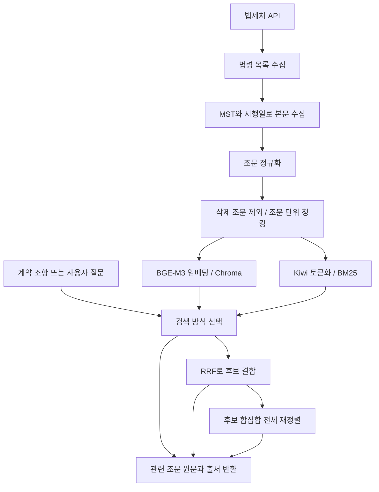

# CheckIt Data

근로계약서 분석 서비스 CheckIt에서 사용할 데이터를 수집·전처리하고 검색용 인덱스로 만드는 저장소입니다. **법제처 API의 법령 원문을 조문 단위로 수집·검색**하며, 기존 근로기준법 평가 인덱스와 근로관계 8개 법령의 통합 인덱스를 별도로 관리합니다.

추가 법령 구축일: **2026-10-27**. 아래 기존 성능 비교는 **2026-10-19 근로기준법 단독 인덱스**의 저장된 평가 결과이며, 통합 인덱스의 성능을 뜻하지 않습니다.

## 1. 현재 상태와 기본 설정

| 항목 | 현재 상태 |
| --- | --- |
| 법령 수집 | 법제처 API 목록·본문 JSON 수집 완료 |
| 정규화 | 근로기준법 조문 132개 생성 |
| 청킹 | 삭제된 제 35조 제외, 조문당 청크 하나로 131개 생성 |
| 벡터 검색 | BGE-M3 임베딩과 로컬 Chroma 인덱스 구축·검색 확인 |
| 키워드 검색 | Kiwi 형태소 분석 기반 BM25 구축·평가 완료 |
| 검색 결합 | 동일 가중치 RRF, BGE 비중 80:20·70:30 RRF 비교 완료 |
| 재정렬 | dense·BM25 후보 합집합 전체에 BGE Reranker 적용·평가 완료 |
| 인덱스 진단 | Chroma와 전체 벡터 정확 검색의 상위 20개 결과 비교 완료 |
| 임베딩 교체 | Qwen3-Embedding-0.6B 별도 인덱스 구축·비교 완료 |
| 평가 | 초기 12개 → 개발 질의 90개로 확장, 유형별 지표·실행 조건 기록 |
| 기본값 | **BGE-M3 + dense 검색**, `labor_standards_v001` |
| 추가 인덱스 | `employment_laws_v001`: 근로관계 8개 법령, 조문 453개 중 삭제 9개 제외, **444개 청크** |
| 다음 단계 | 추가 법령 평가셋·검수, 청킹·검색 표현 개선 |

현재 구현 범위는 법령 데이터 준비와 검색입니다. 계약서 OCR·개인정보 마스킹·조항 분류 모델·위험 판정·검색 결과를 근거로 한 LLM 설명 생성은 이 파이프라인에 아직 연결하지 않았습니다.

### 기본 모델을 BGE-M3로 유지한 이유

- BGE 단독 검색은 90개 개발 질의에서 **Hit@5 91.1%, MRR@10 0.8142**였습니다.
- Qwen은 계약서 문장 검색에서 일부 개선됐지만 전체 Hit@5는 85.6%였고, 사용자 질문에서 저하됐습니다.
- BGE·BM25 후보를 Reranker로 재정렬한 방식은 **Hit@1 83.3%, Hit@5 93.3%**로 이번 실험의 최고 점수였습니다. 다만 CPU 평균 처리시간이 약 5.6초로, 기본 검색의 약 55ms보다 길었습니다.
- 따라서 현재는 BGE 단독을 기본으로 사용하고, 하이브리드·Reranker·Qwen은 명시적으로 선택하는 실험 기능으로 보존합니다.

공통 기본 corpus는 [`RAG/settings.py`](RAG/settings.py)의 `DEFAULT_CORPUS`에서 관리합니다. 검색·평가에서 `--corpus`를 생략하면 `labor_standards_v001`을 사용합니다. 질의 모델은 선택한 인덱스의 manifest에 기록된 모델과 커밋을 따라갑니다.

## 2. 파이프라인 구조



각 단계는 별도 모듈 명령으로 실행합니다. 전체 수집·가공 단계를 자동으로 연결하는 오케스트레이터는 아직 없습니다. `compare_retrieval`과 `compare_improvements`는 검색 평가를 여러 설정으로 실행하는 비교 도구입니다.

### 검색 방식

| `--method` | 동작 |
| --- | --- |
| `dense` | BGE-M3 등 해당 corpus의 임베딩 모델로 벡터 검색. 기본값 |
| `bm25` | Kiwi 토큰과 BM25 점수로 검색 |
| `hybrid` | dense와 BM25 후보를 동일 가중치 RRF로 결합 |
| `weighted_rrf` | 기본 dense 0.8 / BM25 0.2 기여도로 RRF 결합 |
| `hybrid_rerank` | dense·BM25 후보 합집합 전체를 Reranker로 채점한 뒤 최종 결과 선택 |

RRF는 원래 검색 점수 대신 `가중치 / (rrf_k + 순위)`를 합산합니다. 기본 `candidate-k=20`은 각 검색기별 후보 수이며, 합집합은 최대 40개입니다. `rrf-k=60`은 후보 수가 아닌 RRF 계산 상수입니다. Reranker 방식은 최종 10개로 자르기 전에 전체 합집합을 채점합니다. 이때 가중치 RRF는 사전 순서와 Reranker 점수 동점 처리에 사용됩니다.

## 3. 데이터와 디렉터리

```text
CheckIt_Data/
├── .env.example                   # 환경변수 이름 공유
├── requirements.txt               # RAG 의존성
├── RAG/
│   ├── settings.py                 # 루트 .env, 경로, 기본 corpus
│   ├── config/target_laws.json     # 대상 법령 목록, 수집 코드에는 아직 미연결
│   ├── collection/law_api.py       # 법제처 API 클라이언트
│   ├── preprocessing/             # 조문 정규화, 청킹, Kiwi 토큰화
│   ├── indexing/                  # BGE·Qwen 임베딩, Chroma, BM25
│   ├── retrieval/                 # 검색기, RRF, Reranker
│   ├── evaluation/                # 조문 기준 Hit·Recall·MRR 계산
│   └── pipelines/                 # 수집·가공·검색·평가 CLI
├── data/rag/
│   ├── raw/<run_id>/              # 원본 API 응답, Git 제외
│   ├── processed/<corpus>/        # 정규화·청크·manifest, Git 제외
│   └── evaluation/                # 로컬 평가 데이터
├── storage/rag/                   # 로컬 인덱스·모델 준비 기록, Git 제외
│   ├── labor_standards_v001/      # 기존 BGE 인덱스: chroma/, bm25/
│   ├── labor_standards_qwen_v001/ # Qwen 실험 인덱스
│   └── models/                    # Reranker 모델 커밋·준비 상태
├── outputs/rag/                   # 실행별 결과·메타데이터, Git 제외
└── test/rag/
    ├── datasets/                  # 고정 개발 질의 90개
    ├── baseline/                  # 보존한 최초 90개 평가 결과
    ├── comparisons/               # 공유할 비교 결과 사본
    ├── EXPERIMENT_LOG.md           # 기존 실험 상세 기록
    ├── experiment_history.json    # 기존 실험 메타데이터
    └── test_*.py                  # RRF·Reranker·정확 검색 단위 테스트
```

### 현재 수집 자료

| 항목 | 값 |
| --- | --- |
| 법령 | 근로기준법 |
| 법령 ID / MST | `001872` / `285279` |
| 수집 버전 시행일 | `20261008` |
| 원본 실행 폴더 | `20261019T074221426859Z` |
| 정규화 / 검색 청크 | 132개 / 131개 |
| 청킹 | `one_article_per_chunk_v1`: 조문 하나를 청크 하나로 저장 |
| BGE 임베딩 | `BAAI/bge-m3`, 1,024차원, 벡터 정규화 |
| 거리 | cosine distance |

수집기는 `target=eflaw`의 현행 목록을 조회하고, 목록에서 선택한 MST·시행일로 본문을 요청합니다. 위 값은 이번 실험에 사용한 스냅샷이며 이후 수집에서 동일한 버전이 반환된다는 의미는 아닙니다. 현재 검색 평가는 근로기준법 본칙 조문에 한정되며 다른 법령·부칙·별표는 포함하지 않습니다.

### 레코드와 이력 관리

- `articles.jsonl`: 한 줄에 조문 하나. 장·절 제목을 제외하고 조·항·호·목 본문을 합칩니다. 법령·조문 ID, 제목, 원문, 시행일, 삭제 여부, 출처 URL을 보존합니다.
- `chunks.jsonl`: 위 필드에 `chunk_id`, `chunk_type`, `embedding_text`를 추가합니다. `chunk_id`는 `<article_id>::full`이고 삭제 조문은 제외합니다.
- `embedding_text`: 법령명·조문 번호·제목·본문을 함께 넣는 검색용 텍스트입니다. Chroma의 문서에는 공식 조문 `content`를 저장합니다.
- `manifest.json`, `chunks_manifest.json`, `index_manifest.json`: 원본·입력 해시, 조문·청크 건수, 모델 커밋, 차원, 거리 설정, 패키지 버전을 기록합니다.
- 검색 시 청크 파일 해시·DB 건수·ID·모델 설정을 확인합니다. 모델 입력 한도를 넘는 텍스트는 자동 절단하지 않고 오류로 중단합니다.

BGE 인덱스의 최대 문서 길이는 838토큰으로 모델 제한 8192토큰 안에 있습니다. 항 단위 청킹은 아직 적용하지 않았습니다. 정규화 manifest의 `review_status=PENDING`은 별도 검토가 필요하다는 기록이며, 인덱싱을 자동 차단하는 조건은 아닙니다.

## 4. 성능 평가 결과

### 평가 데이터와 지표

| 평가셋 | 질의 수 | 구성 | 용도 |
| --- | ---: | --- | --- |
| v001 | 12 | 키워드 6개 + 자연어 6개, 주제 6개 | 최초 동작·기준선 확인 |
| v002 | 90 | 키워드 30개 + 사용자 질문 30개 + 계약서 문장 30개, 주제 15개 | 검색 개선 실험 |

고정 개발셋: [`test/rag/datasets/retrieval_dev_v002.jsonl`](test/rag/datasets/retrieval_dev_v002.jsonl).

v002는 v001의 12개 문장을 포함합니다. 문장은 개발용으로 작성했으며 실제 계약서 90건을 의미하지 않습니다. 각 질의에 대표 정답 조문 1개를 지정한 **DRAFT 개발셋**으로, 모든 관련 조문을 망라하거나 법률 전문가 검수를 완료한 정답은 아닙니다. 이미 결과를 보며 개선한 자료이므로 최종 성능은 별도 미사용·검수 평가셋에서 확인해야 합니다.

- **Hit@k**: 정답 조문이 상위k개 안에 포함된 질의의 비율.
- **Recall@k**: 지정한 정답 조문 중 상위k개에서 찾은 비율. 현재는 질의당 정답 1개라 Hit와 같습니다.
- **MRR@10**: 상위 10개 안의 첫 정답 순위 역수 평균. 정답이 1위면 1, 2위면 0.5, 10위 밖이면 0입니다.
- 같은 조문의 여러 청크는 `article_id`로 중복을 제외해 평가합니다. 평가 결과는 검색 품질이며 위험 판정·법률 적용·LLM 답변 정확도를 의미하지 않습니다.

최초 12개 BGE 평가의 Hit@1·Hit@5·MRR@10은 각각 83.3%·83.3%·0.8333이었습니다. 이후 90개로 질의 분포를 확장했으므로 점수 하락 자체를 모델 성능 저하로 해석하지 않습니다.

### 4-1. BM25·RRF·Reranker 비교

동일한 90개 질의와 BGE corpus를 사용했습니다. 최종 평가 깊이는 10개입니다.

| 방식 | Hit@1 | Hit@5 | Hit@10 | MRR@10 | 평균 시간(ms) |
| --- | ---: | ---: | ---: | ---: | ---: |
| BGE-M3 dense | 73.3% | 91.1% | 92.2% | 0.8142 | 58.35 |
| BM25 단독 | 58.9% | 81.1% | 83.3% | 0.6842 | 0.37 |
| 동일 가중치 RRF | 70.0% | 87.8% | 93.3% | 0.7754 | 57.15 |
| BGE:BM25 = 80:20 RRF | 71.1% | 87.8% | 93.3% | 0.7858 | 57.34 |
| BGE:BM25 = 70:30 RRF | 67.8% | 87.8% | 92.2% | 0.7693 | 57.42 |
| 전체 후보 + Reranker | 83.3% | 93.3% | 93.3% | 0.8713 | 5596.17 |

동일 가중치·가중치 RRF·Reranker 행은 같은 추가 비교 실험에서 가져왔고, BM25 행은 앞선 동일 개발셋 비교 실행에서 가져왔습니다. 시간은 각 실행의 CPU 워밍업 후 평균으로 모델 로딩·다운로드·DB 복사 시간을 제외합니다. BM25 단독에는 질의 임베딩이 필요하지 않습니다. 단일 실행의 시간이며 서비스 전체 응답시간이나 통계적 우열을 뜻하지 않습니다.

- BM25는 키워드 Hit@5가 100%였지만 사용자 질문에서는 63.3%였습니다. 일상 표현과 법률 표현의 차이가 관찰됐습니다.
- 동일 가중치 RRF는 dense보다 Hit@5가 낮았습니다. BGE 비중을 높여도 이번 설정에서는 BGE 단독을 넘지 못했습니다.
- 전체 후보 재정렬은 dense 대비 Hit@1을 10.0%p, Hit@5를 2.2%p 개선했습니다. Hit@5 기준 새로 맞힌 질의 2개, 놓치게 된 질의 0개였습니다.
- hybrid 계열 후보 합집합에는 대표 정답이 88/90개(97.8%) 포함됐습니다. 재정렬 후 최종 상위 5개에는 84/90개가 포함됐습니다. dense 후보 지표는 최종 10개 기준 83/90개여서 후보 예산이 다릅니다.

설정: BM25Okapi `k1=1.5`, `b=0.75`, `epsilon=0.25`; Kiwi CoNg 토큰화; 각 검색기 후보 20개; RRF 상수 60. Reranker는 `BAAI/bge-reranker-v2-m3`, batch2, 최대 입력 1024토큰으로 raw logit 점수를 사용했습니다.

근거: [최초 방식 비교](test/rag/comparisons/comparison_20261019T091804328568Z/report/comparison.json), [가중치·재정렬 비교](test/rag/comparisons/improvements_20261019T093558069116Z/report/comparison.json).

### 4-2. Chroma와 전체 벡터 정확 검색 비교

기존 DB의 131개 벡터와 질의별로 한 번 만든 동일 임베딩으로 비교했습니다. 정확 검색은 모든 문서의 cosine을 NumPy float64로 계산했습니다.

| 항목 | 결과 |
| --- | --- |
| 상위 20개 문서와 순서까지 동일 | **90/90개 질의** |
| 양쪽 Hit@1 / Hit@5 / Hit@20 | 73.3% / 91.1% / 95.6% |
| 유의한 근사 검색 누락 질의 | 0개 |

현재 corpus와 개발셋에서는 Chroma 근사 검색 때문에 놓친 결과를 관찰하지 못했습니다. 예를 들어 “중도 퇴사하면 위약금 50만 원을 지급한다.”의 제 20조는 정확 검색에서도 46위였습니다. 이 사례는 인덱스 설정만으로 해결되기보다 임베딩·검색 표현 개선이 필요하다는 근거입니다. 데이터가 커지면 같은 진단을 다시 해야 합니다.

정확 검색 보고서의 MRR은 **@20**이므로 다른 실험의 MRR@10과 직접 비교하지 않습니다. 검색 시간은 임베딩을 제외해 따로 측정했습니다. [보고서](test/rag/comparisons/exact_comparison_20261019T095622836381Z/REPORT.md) / [실행·해석](test/rag/EXACT_SEARCH.md).

### 4-3. BGE-M3와 Qwen 임베딩 비교

원문·청킹을 유지한 채 Qwen corpus를 별도로 생성했습니다. 두 평가의 데이터셋·청크 SHA-256이 같고, 모두 CPU·dense·최종 10개로 실행했습니다. Qwen에는 영어 검색 instruction을 질의에만 적용했습니다.

| 방식 | Hit@1 | Hit@5 | Hit@10 | MRR@10 | 평균 시간(ms) |
| --- | ---: | ---: | ---: | ---: | ---: |
| BGE-M3 | 73.3% | 91.1% | 92.2% | 0.8142 | 54.89 |
| Qwen3-Embedding-0.6B | 73.3% | 85.6% | 91.1% | 0.7981 | 291.77 |

질의 유형별 결과는 다음과 같습니다. 각 유형은 30개입니다.

| 유형 | BGE Hit@5 | Qwen Hit@5 | BGE Hit@10 | Qwen Hit@10 |
| --- | ---: | ---: | ---: | ---: |
| 법률 키워드 | 96.7% | 96.7% | 96.7% | 96.7% |
| 사용자 질문 | 93.3% | 73.3% | 93.3% | 80.0% |
| 계약서 문장 | 83.3% | 86.7% | 86.7% | 96.7% |

- Qwen은 계약서 문장에서 개선됐고, 정답의 상위 10개 포함이 26/30개에서 29/30개로 늘었습니다.
- 사용자 질문 Hit@5는 28/30개에서 22/30개로 줄어 전체 점수가 낮아졌습니다.
- 전체 Hit@5 기준 Qwen은 BGE가 놓친 1개를 찾았지만 BGE가 맞힌 6개를 놓쳤습니다. Hit@1은 8개 개선·8개 악화로 총점이 같았습니다.
- “중도 퇴사하면 위약금 50만 원을 지급한다.”의 제 20조는 BGE 상위 10개 밖에서 Qwen9위로 개선됐지만 상위 5개에는 들지 못했습니다.
- Qwen은 이번 CPU 실행에서 평균 약 5.3배 오래 걸렸습니다. 이를 일반적인 하드웨어 성능 차이로 단정하지 않습니다.

모델 커밋:

| 모델 | 커밋 |
| --- | --- |
| BGE-M3 | `5617a9f61b028005a4858fdac845db406aefb181` |
| Qwen3-Embedding-0.6B | `97b0c614be4d77ee51c0cef4e5f07c00f9eb65b3` |
| BGE Reranker v2 m3 | `953dc6f6f85a1b2dbfca4c34a2796e7dde08d41e` |

두 평가 실행에 기록된 패키지 버전은 같지만, 문서 인덱스 생성 manifest의 torch 버전은 BGE 2.14.1·Qwen 2.11.0으로 다릅니다. 엄밀한 재현 비교에서는 생성 환경도 고정해야 합니다. 이번 결과만으로 모든 한국어 노동법 검색에서 특정 모델이 우월하다고 일반화하지 않습니다.

근거: [BGE 평가 요약](test/rag/comparisons/embeddings_20261019/bge/summary.json), [Qwen 평가 요약](test/rag/comparisons/embeddings_20261019/qwen/summary.json), [Qwen 질의별 결과](test/rag/comparisons/embeddings_20261019/qwen/results.csv). 각 폴더의 `run_metadata.json`에 데이터 해시·코드 해시·모델·환경이 기록돼 있습니다.

## 5. 실행 방법

모든 명령은 저장소 루트에서 `python3 -m`으로 실행합니다. **현재 작업 PC에서는 기존 인덱스를 바로 사용하면 됩니다.** 새로 복제한 환경은 Git에서 제외된 산출물이 없으므로 수집·전처리·인덱싱이 필요합니다. 최초 모델 사용 시 Hugging Face 다운로드와 로컬 저장 공간이 필요합니다.

### 5-1. 환경 준비

```bash
# 가상환경이 없을 때만 생성
python3 -m venv .venv
source .venv/bin/activate
python3 -m pip install -r requirements.txt
cp -n .env.example .env
```

루트 `.env`에 본인의 API 값을 설정합니다. 실제 값은 공유하지 않습니다.

```dotenv
LAW_API_OC=발급받은_OC_값
```

### 5-2. 기존 BGE 인덱스로 검색

```bash
source .venv/bin/activate
python3 -m RAG.pipelines.search \
  --query "중도 퇴사하면 위약금 50만 원을 지급한다." \
  --top-k 10 \
  --device cpu
```

기본 corpus는 `labor_standards_v001`, 방식은 `dense`입니다. 결과에는 조문 원문·번호·출처·거리 등이 출력됩니다. `cosine_distance`는 낮을수록 가깝고 정확도 확률은 아닙니다. BM25·RRF·Reranker 점수 역시 확률로 해석하지 않습니다.

재정렬 검색은 해당 corpus의 BM25와 Reranker 준비가 필요합니다. 기존 작업 PC에는 준비된 자료가 있습니다. 새 환경에서는 각각 최초 한 번 실행합니다.

```bash
python3 -m RAG.pipelines.build_bm25 --corpus labor_standards_v001
python3 -m RAG.pipelines.prepare_reranker --device cpu
```

```bash
python3 -m RAG.pipelines.search \
  --method hybrid_rerank \
  --query "중도 퇴사하면 위약금 50만 원을 지급한다." \
  --candidate-k 20 \
  --dense-weight 0.8 \
  --bm25-weight 0.2 \
  --top-k 10 \
  --device cpu
```

### 5-3. 수집부터 새 인덱스 만들기

```bash
python3 -m RAG.pipelines.collect
```

출력된 원본 폴더 경로로 `RAW_DIR`을 설정합니다. 다음 경로·버전은 이번 실험의 예시이므로 새 수집 시 실제 값으로 변경하세요.

```bash
RAW_DIR="data/rag/raw/20261019T074221426859Z"

python3 -m RAG.pipelines.fetch_body \
  "$RAW_DIR/labor_standards_search.json" \
  --law-name "근로기준법"

CORPUS="labor_standards_v001"
BODY_FILE="$RAW_DIR/law_001872_285279_20261008_body.json"

python3 -m RAG.pipelines.preprocess \
  "$BODY_FILE" --mst 285279 --corpus "$CORPUS"

python3 -m RAG.pipelines.build_chunks \
  "data/rag/processed/$CORPUS/articles.jsonl"

python3 -m RAG.pipelines.build_index \
  --corpus "$CORPUS" \
  --model-name BAAI/bge-m3 \
  --device cpu --batch-size 2

python3 -m RAG.pipelines.build_bm25 --corpus "$CORPUS"
```

기존 산출물은 덮어쓰지 않습니다. 기존 환경에서는 필요한 단계만 실행하고, 재구축 시 새 corpus 이름을 사용하세요.

### 5-4. 검색 평가와 비교

고정 개발셋으로 현재 기본 BGE를 평가합니다.

```bash
python3 -m RAG.pipelines.evaluate \
  --method dense \
  --dataset test/rag/datasets/retrieval_dev_v002.jsonl \
  --run-name bge_default \
  --device cpu
```

비교 모듈은 다음처럼 실행합니다. BM25와 Reranker를 사용하는 비교는 해당 자료가 먼저 준비돼 있어야 합니다.

```bash
# BGE dense / BM25 / 동일 가중치 RRF
python3 -m RAG.pipelines.compare_retrieval \
  --corpus labor_standards_v001 \
  --dataset test/rag/datasets/retrieval_dev_v002.jsonl \
  --candidate-k 20 --rrf-k 60

# dense / 동일 가중치 / 80:20 / 70:30 / 전체 후보 재정렬
python3 -m RAG.pipelines.compare_improvements \
  --corpus labor_standards_v001 \
  --dataset test/rag/datasets/retrieval_dev_v002.jsonl \
  --candidate-k 20 --rrf-k 60

# Chroma와 전체 벡터 정확 검색 진단
python3 -m RAG.pipelines.compare_exact --corpus labor_standards_v001
```

실행마다 `outputs/rag/` 아래 새 결과 폴더가 생깁니다.

| 파일 | 확인 내용 |
| --- | --- |
| `summary.json` | 전체·질문 유형별 Hit, Recall, MRR, 평균 시간 |
| `results.csv` | 질문·정답·순위·상위 결과를 표로 확인 |
| `results.jsonl` | 질문별 상세 결과와 후보 정보 |
| `run_metadata.json` | 모델 커밋, 데이터·코드 해시, 설정·실행 환경 |
| `comparison.json/csv` | 여러 방식을 실행하는 비교 모듈의 집계 |

### 5-5. Qwen 실험 재현

현재 검색 기본값은 BGE입니다. Qwen을 다시 평가할 때만 corpus를 명시합니다. 기존 Qwen 인덱스가 있으면 평가부터 실행하세요.

```bash
# Qwen 인덱스와 가공 폴더가 없는 환경에서만 실행
mkdir data/rag/processed/labor_standards_qwen_v001
cp data/rag/processed/labor_standards_v001/chunks.jsonl \
  data/rag/processed/labor_standards_qwen_v001/chunks.jsonl

python3 -m RAG.pipelines.build_index \
  --corpus labor_standards_qwen_v001 \
  --model-name Qwen/Qwen3-Embedding-0.6B \
  --device cpu --batch-size 2
```

```bash
python3 -m RAG.pipelines.evaluate \
  --corpus labor_standards_qwen_v001 \
  --method dense \
  --dataset test/rag/datasets/retrieval_dev_v002.jsonl \
  --run-name embedding_qwen --device cpu
```

모델을 바꾸면 문서와 질문 모두 같은 새 모델로 임베딩해야 합니다. 차원이 같아도 다른 모델의 벡터를 섞지 않습니다. Qwen과 BM25·Reranker를 결합한 성능 비교는 아직 실행하지 않았습니다.

### 5-6. 코드 검증

```bash
python3 -m unittest discover -s test/rag -p 'test_*.py'
```

코드 변경 확인에서 15개 테스트가 통과했습니다. RRF, 전체 후보 재정렬, 정확 cosine 계산, 다중 법령 수집·병합·재개·중복/미래 버전/본문 불일치 거부가 대상입니다. 법률 판정의 정확도를 검증하는 테스트는 아닙니다.

### 5-7. 백엔드 서버에서 검색 사용

`RAG/service.py`의 `LawSearchService`가 기존 BGE-M3 dense 검색을 제공합니다. Chroma 데이터와 검색 로직은 Data에 그대로 둡니다.

`CheckIt_BE` 폴더에서 백엔드 가상환경에 `python -m pip install -r requirements-rag.txt`로 Data를 editable 설치하고, 백엔드 `.env`에 `CHECKIT_RAG_ENABLED=true`를 설정합니다. 이후 백엔드 서버 하나에서 `POST /api/rag/search`를 제공합니다. 별도 Data HTTP 서버는 없습니다. 인증·입력 형식·테스트 순서는 백엔드 README의 **로컬 Chroma 검색 연결**을 참고하세요.

모델·청크·manifest·Chroma 인덱스가 서버를 실행하는 컴퓨터에 있어야 합니다. 기존 로컬 인덱스는 재생성하거나 덮어쓰지 않습니다. 다른 팀원은 해당 서버의 API를 호출할 경우 Data를 설치할 필요가 없습니다.

### 5-8. 여러 법령 수집·통합 인덱스

대상 목록은 `RAG/config/target_laws.json`에서 관리합니다. 목록에 지정한 법령마다 정확히 일치하는 현행 버전을 선택하고, 반환된 본문의 법령 ID·법령명·시행일을 대조합니다. 선택 시행일이 기준일보다 미래이면 중단합니다. 과거 시점의 모든 법령 버전을 자동 복원하는 기능은 아닙니다.

2026-10-27 수집 결과:

| 법령 | 선택 버전 시행일 | 검색 청크 |
| --- | --- | ---: |
| 근로기준법 | 2026-10-08 | 131 |
| 근로기준법 시행령 | 2025-10-23 | 75 |
| 최저임금법 | 2020-05-26 | 32 |
| 최저임금법 시행령 | 2019-01-01 | 26 |
| 기간제 및 단시간근로자 보호 등에 관한 법률 | 2021-05-18 | 26 |
| 기간제 및 단시간근로자 보호 등에 관한 법률 시행령 | 2021-04-08 | 7 |
| 근로자퇴직급여 보장법 | 2026-09-18 | 68 |
| 근로자퇴직급여 보장법 시행령 | 2026-03-24 | 79 |
| **합계** | | **444** |

저장 후 법령별 표본 8개와 검색 질문 4개로 조회를 확인했고, 기존 131개 인덱스의 문서 수·청크 해시 보존도 확인했습니다. 이는 연결·저장 검증이며 검색 정확도 평가를 대신하지 않습니다.

기존 근로기준법 개발 질의 90개를 통합 인덱스에서도 실행한 결과, 대표 정답 조문 기준 Hit@1 **65.6%**, Hit@5 **85.6%**, MRR@10 **0.7509**였습니다. 기존 단독 인덱스의 Hit@5 91.1%보다 낮으므로 범위 확대가 검색 정확도 향상을 의미하지 않습니다. 새 법령의 관련 조문이 기존 단일 정답에 포함돼 있지 않을 수도 있어 결과별 검수와 새 법령을 포함한 별도 평가가 필요합니다. [요약](test/rag/comparisons/employment_laws_v001_20261027/summary.json) · [질의별 결과](test/rag/comparisons/employment_laws_v001_20261027/results.csv) · [실행 조건](test/rag/comparisons/employment_laws_v001_20261027/run_metadata.json).

본칙의 조문만 포함하고 부칙·별표·시행규칙·고시·다른 계약서 유형의 법령은 포함하지 않습니다. 최저임금의 연도별 금액 등 고시 자료를 수집한 것은 아닙니다. 전문가 검수 상태는 `PENDING`이며, 별도 평가셋 검증이 필요합니다.

현재 PC에 구축된 통합 인덱스 검색:

```bash
python3 -m RAG.pipelines.search --corpus employment_laws_v001 \
  --query "최저임금보다 적게 지급하기로 한 근로계약" --top-k 5 --device cpu
```

새 환경에서의 전체 구축 순서입니다. 이미 존재하는 corpus는 덮어쓰지 않으므로 재수집할 때는 새 버전 이름을 사용하세요.

```bash
python3 -m RAG.pipelines.collect_corpus --corpus employment_laws_v001
python3 -m RAG.pipelines.build_index --corpus employment_laws_v001 \
  --model-name BAAI/bge-m3 \
  --revision 5617a9f61b028005a4858fdac845db406aefb181 \
  --device cpu --batch-size 2
python3 -m RAG.pipelines.build_bm25 --corpus employment_laws_v001
```

`collect_corpus`는 원본 수집 폴더를 출력하며, 원본·법령별 버전·SHA-256·조문/청크 건수를 기록합니다. 중간 수집 실패 시 같은 설정과 기준일로 `--resume data/rag/raw/<run_id> --as-of YYYYMMDD`를 지정하면 검증된 본문을 다시 요청하지 않고 재개합니다. 가공 결과가 이미 생성된 경우에는 새 corpus 이름을 사용합니다.

벡터·BM25 생성은 후속 단계입니다. 입력 해시·문서 수·ID를 검증하며, 모델 입력 제한을 넘으면 자동 절단하지 않고 중단합니다. 새 인덱스의 manifest에는 임베딩 모델 커밋이 기록됩니다.

기존 평가 재현을 위해 Data 기본 corpus는 `labor_standards_v001`로 유지합니다. 백엔드에서 통합 인덱스를 사용하려면 백엔드 `.env`의 `CHECKIT_RAG_CORPUS=employment_laws_v001`로 변경하고 서버를 재시작하세요. 이번 Data 작업은 백엔드 설정을 자동 변경하지 않습니다.

## 6. Git 공유와 재현성

- 공유 대상: 소스, 의존성 목록, `.env.example`, 개발 평가셋, `test/rag/`에 보존한 비교 결과, README.
- Git 제외: `.env`, `.venv/`, `data/rag/raw/`, `data/rag/processed/`, `storage/`, `outputs/` 등. 원본 API 응답도 제외 상태를 유지합니다.
- `data/rag/evaluation/`은 현재 Git 제외 규칙의 대상이 아닙니다. 별도 파이프라인 추가 시 제외 규칙도 함께 갱신합니다.
- 모델 가중치는 Hugging Face 로컬 캐시에 있고, `storage/rag/models/`는 가중치 자체가 아닌 준비 상태·커밋 기록입니다.
- 패키지는 requirements에서 범위로 지정하며 완전히 고정된 lock 파일은 아직 없습니다. 실행 버전은 manifest와 평가 메타데이터에 기록합니다.

기존 상세 기록: [실험 로그](test/rag/EXPERIMENT_LOG.md), [기존 실험 메타데이터](test/rag/experiment_history.json), [평가 자료 안내](test/rag/README.md). 이후 추가된 BGE·Qwen 비교는 이 README의 4-3절과 링크된 보존 결과를 확인하세요.

## 7. 다음 개선 과제

1. **미사용 평가 데이터 수집·검수**: 실제 계약서 문장·질문을 추가하고, 여러 관련 조문의 정답 지정과 같은 계약서·유사 문장의 데이터 분할을 검토합니다.
2. **검색용 텍스트 개선**: 퇴사/퇴직, 월급/임금 등 일상어와 법률어 차이를 처리합니다. 공식 원문과 추가 설명을 분리하고 인용은 원문을 사용합니다.
3. **긴 조문의 항 단위 청킹**: 부모 조문 ID를 유지하고 작은 청크로 검색한 뒤 조문 전체를 가져옵니다. 같은 조문의 중복 후보를 묶어 평가합니다.
4. **재정렬 개선**: 후보에 정답이 있는데 순위가 낮은 사례를 분석하고 입력 표현·모델·후보 수와 응답시간을 비교합니다.
5. **추가 법령 검증**: `target_laws.json` 기반 8개 법령 수집·통합 구축 후, 추가 법령의 질의·정답 조문을 검수하고 검색 누락·순위와 시행일 메타데이터를 점검합니다. 별표·부칙·고시 등은 별도 수집 설계가 필요합니다.
6. **서비스 연결**: 계약서 OCR·조항 분류 결과를 검색에 전달하고 근거 조문을 인용해 설명을 생성합니다. 금액 비교·필수 항목 누락 판정은 검색 평가와 별도로 설계·검증합니다.

다른 목적의 학습 데이터 생성·전처리는 `RAG/`와 나란히 별도 패키지로 추가하고 루트 `.env`·requirements를 공유할 수 있습니다. 판례·행정 해석처럼 구조가 다른 출처는 전용 수집기·정규화기와 스키마를 정의해야 합니다.
