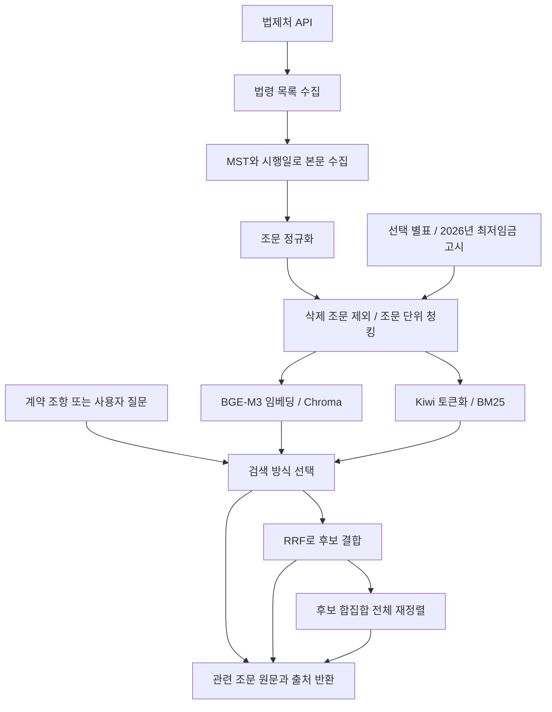

# CheckIt Data

## 최근 변경 요약 (2026-11-09)

1. **법령 데이터 보완:** 12개 법령 본칙·별표 8개·2026년 최저임금 고시를 포함한 **503청크** 인덱스 `employment_basic_v004`를 구축했습니다. 공식 원문을 보존하고 검색용 텍스트·용어를 별도로 보완했습니다.
2. **서비스 입력 확정:** RAG는 **분류 라벨 + 해당 조항 원문**을 받습니다. `clause_id`, `labels`, `text`, `top_k`를 전달하고, 라벨은 작은 우선순위 신호로만 사용합니다. 빈 라벨은 `[]`로 유지하고 원문 검색만 수행합니다. 기존 질문 검색은 호환용으로 유지합니다.
3. **조항 기준 검증:** 수동 라벨을 붙인 합성 계약서 문장 30개에서 Hit@1은 **66.7%→70.0%**, Hit@5는 **93.3%(28/30)로 동일**했습니다. 평균 검색 시간은 약 61ms입니다. 실제 분류 모델 출력·실제 계약서에 대한 종단간 평가가 아닙니다.
4. **백엔드 분석 연결:** 백엔드는 확정된 근로계약서 원문을 분류하고, 필수 항목 누락·위약금·최저임금·가산수당·휴게시간 문제 후보별로 이 저장소의 법령 검색을 호출합니다. 검색 결과와 원문을 Gemini에 전달해 JSON 판단을 저장하는 비동기 job을 추가했습니다. 백엔드 기본 테스트 **105개**가 통과했습니다. Data 테스트 **25개**는 이전 확인 기준입니다.

이 저장소의 완료 범위는 **데이터 준비·근거 검색**입니다. 규칙 후보 생성과 Gemini 판단·DB 저장은 `CheckIt_BE`에 구현되어 있으며, 기존에 저장된 확정 텍스트가 있어야 실행할 수 있습니다. 업로드·OCR·텍스트 확정 API와 실제 계약서에 대한 전문가 검증은 아직 없습니다. 기존 검색 평가는 새 판단 단계의 정확도 평가가 아닙니다. [라벨+원문 개발 평가](test/rag/comparisons/labeled_clauses_v001_20261028/REPORT.md)에 검색 입력 규격과 검증 내역을 정리했습니다.


2026-10-28 기본 근로조건 점검을 위한 추가 원문 수집 내역은 [원문 보완 기록](BASIC_LABOR_COVERAGE.md)을 참고하세요. 추가 법령 4개·선택 별표 8개·2026년 최저임금 고시를 포함한 `employment_basic_v004`(503청크)가 현재 검색 기본값입니다. 아래 2026-10-19 실험 및 `labor_standards_v001` 명령 예시는 이전 기준선 재현용이며, 기존 성능을 새 인덱스의 성능으로 해석하지 않습니다.

근로계약서 분석 서비스 CheckIt에서 사용할 법령 원문을 수집·전처리하고 검색 인덱스로 만드는 저장소입니다. 현재 기본 인덱스는 **근로관계 12개 법령 본칙 + 선택 별표 8개 + 2026년 최저임금 고시**, 총 **503개 청크**입니다. 기존 근로기준법 단독 인덱스와 8개 법령 인덱스도 별도로 보존합니다.

현재 기본 인덱스 구축·백엔드 반영일: **2026-10-28**. 8개 법령 인덱스 구축일: **2026-10-27**. 아래 기존 성능 비교는 **2026-10-19 근로기준법 단독 인덱스**의 저장된 평가 결과이며, 통합 인덱스의 성능을 뜻하지 않습니다.

## 1. 현재 상태와 기본 설정

| 항목 | 현재 상태 |
| --- | --- |
| 법령 수집 | 법제처 API로 12개 법령 원문 수집, 선택 별표·고시 원문 보존 |
| 정규화 | 12개 법령 본칙 조문 507개, 삭제 조문 13개 제외 |
| 청킹 | 법령 본칙 494개 + 별표 8개 + 고시 1개 = **503개** |
| 벡터 검색 | BGE-M3 임베딩과 로컬 Chroma 인덱스 구축·검색 확인 |
| 키워드 검색 | 현재 503개 청크의 Kiwi BM25 구축 완료, 성능 비교는 이전 131개 인덱스 기준 |
| 검색 결합 | 동일 가중치 RRF, BGE 비중 80:20·70:30 RRF 비교 완료 |
| 재정렬 | dense·BM25 후보 합집합 전체에 BGE Reranker 적용·평가 완료 |
| 인덱스 진단 | Chroma와 전체 벡터 정확 검색의 상위 20개 결과 비교 완료 |
| 임베딩 교체 | Qwen3-Embedding-0.6B 별도 인덱스 구축·비교 완료 |
| 평가 | 현재 503개 인덱스: 기존 90개 DRAFT 질의 Hit@5 95.6%, 추가 42개 합성 DRAFT 질의 100%, 추가 표현 14개 64.3%. 실제 계약서·전문가 검수 평가 전 |
| 기본값 | **BGE-M3 + dense 검색**, `employment_basic_v004` (503청크) |
| 추가 인덱스 | `employment_laws_v001`: 근로관계 8개 법령, 조문 453개 중 삭제 9개 제외, **444개 청크** |
| 백엔드 연결 | 라벨+조항 원문 검색과 확정 근로계약서의 규칙 후보·Gemini 분석 job에서 법령 근거 제공 |
| 다음 단계 | 실제 계약서·전문가 검수 평가, 미해결 검색·기간 처리 개선 |

Data 패키지의 구현 범위는 법령 데이터 준비와 검색입니다. 조항 분류 모델·규칙 후보·LLM 판단은 백엔드에 있으며 Data 패키지의 공개 검색 인터페이스는 `LawSearchService.search`와 `search_clause`입니다. OCR과 개인정보 마스킹은 이 파이프라인에 연결되지 않았습니다.

### 기본 모델을 BGE-M3로 유지한 이유

아래 수치는 2026-10-19의 `labor_standards_v001`(131청크) 실험 결과입니다. 현재 503개 인덱스의 성능 수치가 아닙니다.

- BGE 단독 검색은 90개 개발 질의에서 **Hit@5 91.1%, MRR@10 0.8142**였습니다.
- Qwen은 계약서 문장 검색에서 일부 개선됐지만 전체 Hit@5는 85.6%였고, 사용자 질문에서 저하됐습니다.
- BGE·BM25 후보를 Reranker로 재정렬한 방식은 **Hit@1 83.3%, Hit@5 93.3%**로 이번 실험의 최고 점수였습니다. 다만 CPU 평균 처리시간이 약 5.6초로, 기본 검색의 약 55ms보다 길었습니다.
- 따라서 현재는 BGE 단독을 기본으로 사용하고, 하이브리드·Reranker·Qwen은 명시적으로 선택하는 실험 기능으로 보존합니다.

검색용 표현은 HTML·표 테두리를 정리하고, 7개 조문의 보충어를 임베딩 입력에만 추가합니다. `content`는 공식 원문 그대로이며 보충어는 법적 판단·공식 원문이 아닙니다. [실패 사례 보완·전후 평가](test/rag/comparisons/employment_basic_v004_improvements_20261028/REPORT.md)를 참고하세요.

공통 기본 corpus는 [`RAG/settings.py`](RAG/settings.py)의 `DEFAULT_CORPUS`에서 관리합니다. 검색·평가에서 `--corpus`를 생략하면 `employment_basic_v004`를 사용합니다. 기존 평가를 재현하려면 `--corpus labor_standards_v001`을 명시하세요. 질의 모델은 선택한 인덱스의 manifest에 기록된 모델과 커밋을 따라갑니다.

## 2. 파이프라인 구조



각 단계는 별도 모듈 명령으로 실행합니다. 전체 수집·가공 단계를 자동으로 연결하는 오케스트레이터는 아직 없습니다. `compare_retrieval`과 `compare_improvements`는 검색 평가를 여러 설정으로 실행하는 비교 도구입니다.

### 검색 방식

| `--method` | 동작 |
| --- | --- |
| `dense` | BGE-M3 등 해당 corpus의 임베딩 모델로 벡터 검색. 기본값 |
| `bm25` | Kiwi 토큰과 BM25 점수로 검색 |
| `hybrid` | dense와 BM25 후보를 동일 가중치 RRF로 결합 |
| `weighted_rrf` | 기본 dense 0.8 / BM25 0.2 기여도로 RRF 결합 |
| `hybrid_rerank` | dense·BM25 후보 합집합 전체를 Reranker로 채점한 뒤 최종 결과 선택 |

RRF는 원래 검색 점수 대신 `가중치 / (rrf_k + 순위)`를 합산합니다. 기본 `candidate-k=20`은 각 검색기별 후보 수이며, 합집합은 최대 40개입니다. `rrf-k=60`은 후보 수가 아닌 RRF 계산 상수입니다. Reranker 방식은 최종 10개로 자르기 전에 전체 합집합을 채점합니다. 이때 가중치 RRF는 사전 순서와 Reranker 점수 동점 처리에 사용됩니다.

## 3. 데이터와 디렉터리

```text
CheckIt_Data/
├── .env.example                   # 환경변수 이름 공유
├── requirements.txt               # RAG 의존성
├── RAG/
│   ├── settings.py                 # 루트 .env, 경로, 기본 corpus
│   ├── config/target_laws.json     # collect_corpus 기본 대상 8개 법령
│   ├── config/basic_labor_supplements.json # 추가 시행규칙·공휴일 규정 4개
│   ├── config/search_concepts.json # 원문과 분리한 검색용 보충어 7개 조문
│   ├── collection/law_api.py       # 법제처 API 클라이언트
│   ├── preprocessing/             # 조문 정규화, 청킹, Kiwi 토큰화
│   ├── indexing/                  # BGE·Qwen 임베딩, Chroma, BM25
│   ├── retrieval/                 # 검색기, RRF, Reranker
│   ├── evaluation/                # 조문 기준 Hit·Recall·MRR 계산
│   └── pipelines/                 # 수집·가공·검색·평가 CLI
├── data/rag/
│   ├── raw/<run_id>/              # 원본 API 응답, Git 제외
│   ├── processed/<corpus>/        # 정규화·청크·manifest, Git 제외
│   └── evaluation/                # 로컬 평가 데이터
├── storage/rag/                   # 로컬 인덱스·모델 준비 기록, Git 제외
│   ├── employment_basic_v004/     # 현재 기본 503개: chroma/, bm25/
│   ├── employment_laws_v001/      # 기존 8개 법령 444개
│   ├── labor_standards_v001/      # 기존 BGE 인덱스 131개: chroma/, bm25/
│   ├── labor_standards_qwen_v001/ # Qwen 실험 인덱스
│   └── models/                    # Reranker 모델 커밋·준비 상태
├── outputs/rag/                   # 실행별 결과·메타데이터, Git 제외
└── test/rag/
    ├── datasets/                  # 고정 개발 질의 90개
    ├── baseline/                  # 보존한 최초 90개 평가 결과
    ├── comparisons/               # 공유할 비교 결과 사본
    ├── EXPERIMENT_LOG.md           # 기존 실험 상세 기록
    ├── experiment_history.json    # 기존 실험 메타데이터
    └── test_*.py                  # RRF·Reranker·정확 검색 단위 테스트
```

### 현재 기본 인덱스 구성

| 자료 | 청크 수 |
| --- | ---: |
| 기존 8개 법령 본칙 (`employment_laws_v001`) | 444 |
| 근로기준법 시행규칙 | 21 |
| 최저임금법 시행규칙 | 7 |
| 근로자퇴직급여 보장법 시행규칙 | 18 |
| 관공서의 공휴일에 관한 규정 | 4 |
| 근로기준법 시행령 별표 1·2 | 2 |
| 기간제법 시행령 별표 1 | 1 |
| 2026년 적용 최저임금 고시 | 1 |
| 시행규칙의 참조 별표 5개 추가 | 5 |
| **합계** | **503** |

고시의 적용 기간은 **2026-01-01~2026-12-31**입니다. 검색 결과는 `source_type`, `valid_from`, `valid_to` 등 자료에 존재하는 메타데이터를 보존합니다. **질문에 명시한 연도로 연간 고시를 필터링**하고 미수집 연도는 API `warnings`로 알립니다. 일반 법령의 과거 버전은 자동 복원하지 않습니다. 고시의 월 환산액은 주 40시간·월 209시간 조건이며 모든 계약서에 일괄 적용하지 않습니다.

현재 범위는 기본 근로조건 관련 근거 검색입니다. 비밀유지·경업금지·사회보험·용역·파견·저작권에 대한 종합 판단까지 지원하는 것은 아닙니다. 법령·별표 검수 상태는 `PENDING`입니다. 수집 버전·원본 위치·검증 내역은 [원문 보완 기록](BASIC_LABOR_COVERAGE.md)을 확인하세요.

### 이전 근로기준법 기준선 수집 자료

| 항목 | 값 |
| --- | --- |
| 법령 | 근로기준법 |
| 법령 ID / MST | `001872` / `285279` |
| 수집 버전 시행일 | `20261008` |
| 원본 실행 폴더 | `20261019T074221426859Z` |
| 정규화 / 검색 청크 | 132개 / 131개 |
| 청킹 | `one_article_per_chunk_v1`: 조문 하나를 청크 하나로 저장 |
| BGE 임베딩 | `BAAI/bge-m3`, 1,024차원, 벡터 정규화 |
| 거리 | cosine distance |

수집기는 `target=eflaw`의 현행 목록을 조회하고, 목록에서 선택한 MST·시행일로 본문을 요청합니다. 위 값은 이번 실험에 사용한 스냅샷이며 이후 수집에서 동일한 버전이 반환된다는 의미는 아닙니다. 2026-10-19 검색 평가는 근로기준법 본칙 조문에 한정됐습니다. 현재 기본 인덱스의 범위는 위 구성표를 따르며, 모든 부칙·별표를 포함하는 것은 아닙니다.

### 레코드와 이력 관리

- `articles.jsonl`: 한 줄에 조문 하나. 장·절 제목을 제외하고 조·항·호·목 본문을 합칩니다. 법령·조문 ID, 제목, 원문, 시행일, 삭제 여부, 출처 URL을 보존합니다.
- `chunks.jsonl`: 위 필드에 `chunk_id`, `chunk_type`, `embedding_text`를 추가합니다. `chunk_id`는 `<article_id>::full`이고 삭제 조문은 제외합니다.
- `embedding_text`: 법령명·조문 번호·제목·본문을 함께 넣는 검색용 텍스트입니다. Chroma의 문서에는 공식 조문 `content`를 저장합니다.
- `manifest.json`, `chunks_manifest.json`, `index_manifest.json`: 원본·입력 해시, 조문·청크 건수, 모델 커밋, 차원, 거리 설정, 패키지 버전을 기록합니다.
- 검색 시 청크 파일 해시·DB 건수·ID·모델 설정을 확인합니다. 모델 입력 한도를 넘는 텍스트는 자동 절단하지 않고 오류로 중단합니다.

현재 기본 BGE 인덱스의 최대 문서 길이는 **1058토큰**으로 모델 제한 8192토큰 안에 있습니다. 이전 131개 인덱스의 최대 길이는 838토큰입니다. 항 단위 청킹은 아직 적용하지 않았습니다. 정규화 manifest의 `review_status=PENDING`은 별도 검토가 필요하다는 기록이며, 인덱싱을 자동 차단하는 조건은 아닙니다.

## 4. 이전 인덱스의 성능 평가 결과

4-1~4-3은 `labor_standards_v001`(131청크) 기준입니다. 보완 전 `employment_basic_v002`(498청크)의 평가 결과는 **4-4절**, 현재 503개 보완 버전의 결과는 **4-5절**에 기록합니다. 기존 8개 법령 인덱스의 최초 평가 기록은 5-8절에 있습니다.

### 평가 데이터와 지표

| 평가셋 | 질의 수 | 구성 | 용도 |
| --- | ---: | --- | --- |
| v001 | 12 | 키워드 6개 + 자연어 6개, 주제 6개 | 최초 동작·기준선 확인 |
| v002 | 90 | 키워드 30개 + 사용자 질문 30개 + 계약서 문장 30개, 주제 15개 | 검색 개선 실험 |

고정 개발셋: [`test/rag/datasets/retrieval_dev_v002.jsonl`](test/rag/datasets/retrieval_dev_v002.jsonl).

v002는 v001의 12개 문장을 포함합니다. 문장은 개발용으로 작성했으며 실제 계약서 90건을 의미하지 않습니다. 각 질의에 대표 정답 조문 1개를 지정한 **DRAFT 개발셋**으로, 모든 관련 조문을 망라하거나 법률 전문가 검수를 완료한 정답은 아닙니다. 이미 결과를 보며 개선한 자료이므로 최종 성능은 별도 미사용·검수 평가셋에서 확인해야 합니다.

- **Hit@k**: 정답 조문이 상위k개 안에 포함된 질의의 비율.
- **Recall@k**: 지정한 정답 조문 중 상위k개에서 찾은 비율. 현재는 질의당 정답 1개라 Hit와 같습니다.
- **MRR@10**: 상위 10개 안의 첫 정답 순위 역수 평균. 정답이 1위면 1, 2위면 0.5, 10위 밖이면 0입니다.
- 같은 조문의 여러 청크는 `article_id`로 중복을 제외해 평가합니다. 평가 결과는 검색 품질이며 위험 판정·법률 적용·LLM 답변 정확도를 의미하지 않습니다.

최초 12개 BGE 평가의 Hit@1·Hit@5·MRR@10은 각각 83.3%·83.3%·0.8333이었습니다. 이후 90개로 질의 분포를 확장했으므로 점수 하락 자체를 모델 성능 저하로 해석하지 않습니다.

### 4-1. BM25·RRF·Reranker 비교

동일한 90개 질의와 BGE corpus를 사용했습니다. 최종 평가 깊이는 10개입니다.

| 방식 | Hit@1 | Hit@5 | Hit@10 | MRR@10 | 평균 시간(ms) |
| --- | ---: | ---: | ---: | ---: | ---: |
| BGE-M3 dense | 73.3% | 91.1% | 92.2% | 0.8142 | 58.35 |
| BM25 단독 | 58.9% | 81.1% | 83.3% | 0.6842 | 0.37 |
| 동일 가중치 RRF | 70.0% | 87.8% | 93.3% | 0.7754 | 57.15 |
| BGE:BM25 = 80:20 RRF | 71.1% | 87.8% | 93.3% | 0.7858 | 57.34 |
| BGE:BM25 = 70:30 RRF | 67.8% | 87.8% | 92.2% | 0.7693 | 57.42 |
| 전체 후보 + Reranker | 83.3% | 93.3% | 93.3% | 0.8713 | 5596.17 |

동일 가중치·가중치 RRF·Reranker 행은 같은 추가 비교 실험에서 가져왔고, BM25 행은 앞선 동일 개발셋 비교 실행에서 가져왔습니다. 시간은 각 실행의 CPU 워밍업 후 평균으로 모델 로딩·다운로드·DB 복사 시간을 제외합니다. BM25 단독에는 질의 임베딩이 필요하지 않습니다. 단일 실행의 시간이며 서비스 전체 응답시간이나 통계적 우열을 뜻하지 않습니다.

- BM25는 키워드 Hit@5가 100%였지만 사용자 질문에서는 63.3%였습니다. 일상 표현과 법률 표현의 차이가 관찰됐습니다.
- 동일 가중치 RRF는 dense보다 Hit@5가 낮았습니다. BGE 비중을 높여도 이번 설정에서는 BGE 단독을 넘지 못했습니다.
- 전체 후보 재정렬은 dense 대비 Hit@1을 10.0%p, Hit@5를 2.2%p 개선했습니다. Hit@5 기준 새로 맞힌 질의 2개, 놓치게 된 질의 0개였습니다.
- hybrid 계열 후보 합집합에는 대표 정답이 88/90개(97.8%) 포함됐습니다. 재정렬 후 최종 상위 5개에는 84/90개가 포함됐습니다. dense 후보 지표는 최종 10개 기준 83/90개여서 후보 예산이 다릅니다.

설정: BM25Okapi `k1=1.5`, `b=0.75`, `epsilon=0.25`; Kiwi CoNg 토큰화; 각 검색기 후보 20개; RRF 상수 60. Reranker는 `BAAI/bge-reranker-v2-m3`, batch2, 최대 입력 1024토큰으로 raw logit 점수를 사용했습니다.

근거: [최초 방식 비교](test/rag/comparisons/comparison_20261019T091804328568Z/report/comparison.json), [가중치·재정렬 비교](test/rag/comparisons/improvements_20261019T093558069116Z/report/comparison.json).

### 4-2. Chroma와 전체 벡터 정확 검색 비교

기존 DB의 131개 벡터와 질의별로 한 번 만든 동일 임베딩으로 비교했습니다. 정확 검색은 모든 문서의 cosine을 NumPy float64로 계산했습니다.

| 항목 | 결과 |
| --- | --- |
| 상위 20개 문서와 순서까지 동일 | **90/90개 질의** |
| 양쪽 Hit@1 / Hit@5 / Hit@20 | 73.3% / 91.1% / 95.6% |
| 유의한 근사 검색 누락 질의 | 0개 |

현재 corpus와 개발셋에서는 Chroma 근사 검색 때문에 놓친 결과를 관찰하지 못했습니다. 예를 들어 “중도 퇴사하면 위약금 50만 원을 지급한다.”의 제 20조는 정확 검색에서도 46위였습니다. 이 사례는 인덱스 설정만으로 해결되기보다 임베딩·검색 표현 개선이 필요하다는 근거입니다. 데이터가 커지면 같은 진단을 다시 해야 합니다.

정확 검색 보고서의 MRR은 **@20**이므로 다른 실험의 MRR@10과 직접 비교하지 않습니다. 검색 시간은 임베딩을 제외해 따로 측정했습니다. [보고서](test/rag/comparisons/exact_comparison_20261019T095622836381Z/REPORT.md) / [실행·해석](test/rag/EXACT_SEARCH.md).

### 4-3. BGE-M3와 Qwen 임베딩 비교

원문·청킹을 유지한 채 Qwen corpus를 별도로 생성했습니다. 두 평가의 데이터셋·청크 SHA-256이 같고, 모두 CPU·dense·최종 10개로 실행했습니다. Qwen에는 영어 검색 instruction을 질의에만 적용했습니다.

| 방식 | Hit@1 | Hit@5 | Hit@10 | MRR@10 | 평균 시간(ms) |
| --- | ---: | ---: | ---: | ---: | ---: |
| BGE-M3 | 73.3% | 91.1% | 92.2% | 0.8142 | 54.89 |
| Qwen3-Embedding-0.6B | 73.3% | 85.6% | 91.1% | 0.7981 | 291.77 |

질의 유형별 결과는 다음과 같습니다. 각 유형은 30개입니다.

| 유형 | BGE Hit@5 | Qwen Hit@5 | BGE Hit@10 | Qwen Hit@10 |
| --- | ---: | ---: | ---: | ---: |
| 법률 키워드 | 96.7% | 96.7% | 96.7% | 96.7% |
| 사용자 질문 | 93.3% | 73.3% | 93.3% | 80.0% |
| 계약서 문장 | 83.3% | 86.7% | 86.7% | 96.7% |

- Qwen은 계약서 문장에서 개선됐고, 정답의 상위 10개 포함이 26/30개에서 29/30개로 늘었습니다.
- 사용자 질문 Hit@5는 28/30개에서 22/30개로 줄어 전체 점수가 낮아졌습니다.
- 전체 Hit@5 기준 Qwen은 BGE가 놓친 1개를 찾았지만 BGE가 맞힌 6개를 놓쳤습니다. Hit@1은 8개 개선·8개 악화로 총점이 같았습니다.
- “중도 퇴사하면 위약금 50만 원을 지급한다.”의 제 20조는 BGE 상위 10개 밖에서 Qwen9위로 개선됐지만 상위 5개에는 들지 못했습니다.
- Qwen은 이번 CPU 실행에서 평균 약 5.3배 오래 걸렸습니다. 이를 일반적인 하드웨어 성능 차이로 단정하지 않습니다.

모델 커밋:

| 모델 | 커밋 |
| --- | --- |
| BGE-M3 | `5617a9f61b028005a4858fdac845db406aefb181` |
| Qwen3-Embedding-0.6B | `97b0c614be4d77ee51c0cef4e5f07c00f9eb65b3` |
| BGE Reranker v2 m3 | `953dc6f6f85a1b2dbfca4c34a2796e7dde08d41e` |

두 평가 실행에 기록된 패키지 버전은 같지만, 문서 인덱스 생성 manifest의 torch 버전은 BGE 2.14.1·Qwen 2.11.0으로 다릅니다. 엄밀한 재현 비교에서는 생성 환경도 고정해야 합니다. 이번 결과만으로 모든 한국어 노동법 검색에서 특정 모델이 우월하다고 일반화하지 않습니다.

근거: [BGE 평가 요약](test/rag/comparisons/embeddings_20261019/bge/summary.json), [Qwen 평가 요약](test/rag/comparisons/embeddings_20261019/qwen/summary.json), [Qwen 질의별 결과](test/rag/comparisons/embeddings_20261019/qwen/results.csv). 각 폴더의 `run_metadata.json`에 데이터 해시·코드 해시·모델·환경이 기록돼 있습니다.

### 4-4. 보완 전 498개 통합 인덱스 검증·검색 평가 (2026-10-28)

원본·시행 버전·정규화·청크 해시·문서/메타데이터·벡터 등 **17/17개 무결성 검사**를 통과했습니다. 저장 무결성과 법률 해석·자료 완전성은 구분합니다.

기존의 동일한 90개 DRAFT 질의로 세 인덱스를 CPU·BGE-M3 dense·최종 10개 조건에서 순차 평가했습니다.

| 인덱스 | Hit@1 | Hit@5 | Hit@10 | MRR@10 |
| --- | ---: | ---: | ---: | ---: |
| 근로기준법 단독 131개 | 73.3% | 91.1% | 92.2% | 0.8142 |
| 기존 8개 법령 444개 | 65.6% | 85.6% | 91.1% | 0.7509 |
| 보완 전 498개 | 63.3% | **85.6% (77/90)** | 90.0% | 0.7378 |

추가 범위는 [별도 개발셋](test/rag/datasets/retrieval_supplements_v001.jsonl)으로 평가했습니다. 추가 원문에 근거한 14개 주제·42개 합성 질의이며, 키워드·사용자 질문·상황 설명이 각 14개입니다.

| 추가 42개 질의 | 결과 |
| --- | ---: |
| Hit@1 | 76.2% (32/42) |
| Hit@5 | **97.6% (41/42)** |
| Hit@10 | 100.0% (42/42) |
| MRR@10 | 0.8532 |

대체공휴일 사용자 질문의 목표 조문이 6위로 밀렸습니다. 기간제법의 소규모 사업장 적용 별표는 세 질의 모두 상위 5개에 있지만 1위는 아니었습니다. 기존 90개에서는 444개 인덱스 대비 Hit@5 개선·후퇴 질의가 모두 0개입니다. Hit@1에서 기존 대표 정답을 밀어낸 시행규칙이 실제로 관련된 규정인 경우도 있어 정답 검수가 필요합니다.

**97.6%는 실제 계약서 분석 정확도가 아닙니다.** 원문 기반으로 작성한 미검수 합성 개발셋으로, 주제 내 표현이 서로 연관되고 이전 동작 확인과 일부 주제가 겹칩니다. 새로운 54개 청크 중 14개 목표 문서의 표본 평가이며 전문가 검수·실제 입력·법률 판정 평가는 아직 필요합니다.

품질 점검에서 공식 API 표현의 이미지 태그가 남은 조문 2개, 참조 별표 일부 미수집, 날짜 자동 필터 미구현을 확인했습니다. 평가 중 원문·청크·모델·서비스 인덱스는 변경하지 않았습니다. [상세 보고서·실패 사례](test/rag/comparisons/employment_basic_v002_20261028/REPORT.md) · [무결성 결과](test/rag/comparisons/employment_basic_v002_20261028/integrity_audit.json) · [비교 집계](test/rag/comparisons/employment_basic_v002_20261028/comparison.json).

### 4-5. 실패 사례 보완 버전 v004 (503청크)

| 평가셋 | v002 보완 전 Hit@5 | v004 보완 후 Hit@5 |
| --- | ---: | ---: |
| 기존 90개 | 85.6% (77/90) | **95.6% (86/90)** |
| 추가 자료 합성 42개 | 97.6% (41/42) | **100% (42/42)** |
| 추가 표현 합성 14개 | 42.9% (6/14) | **64.3% (9/14)** |

같은 질의·대표 정답을 보존했고 기본 검색 방식은 dense로 유지했습니다. 기존 90개에서 새로 맞힌 질의는 9개, 기존 정답을 놓친 질의는 0개입니다. 평균 검색 시간은 약 55ms로 유지됐습니다. 모호한 퇴사 조건과 대여금·임금 공제 복합 문장 등 기존 4개 질의는 여전히 상위 5개 밖입니다.

오류 분석 후 검색용 보충어를 설계했으므로 **개발셋 개선 수치**입니다. 추가 표현 14개도 같은 작성자가 만든 미검수 합성 자료이며 실제 계약서·독립 최종 평가가 아닙니다. 최종 인덱스 무결성 검사 15개, Data 테스트 19개, 백엔드 RAG 테스트 13개, 실제 API 8건을 통과했습니다. [사례별 전후 순위·남은 실패·재현 방법](test/rag/comparisons/employment_basic_v004_improvements_20261028/REPORT.md).

## 5. 실행 방법

모든 명령은 저장소 루트에서 `python3 -m`으로 실행합니다. **현재 작업 PC에서는 기존 인덱스를 바로 사용하면 됩니다.** 새로 복제한 환경은 Git에서 제외된 산출물이 없으므로 수집·전처리·인덱싱이 필요합니다. 최초 모델 사용 시 Hugging Face 다운로드와 로컬 저장 공간이 필요합니다.

### 5-1. 환경 준비

```bash
# 가상환경이 없을 때만 생성
python3 -m venv .venv
source .venv/bin/activate
python3 -m pip install -r requirements.txt
cp -n .env.example .env
```

루트 `.env`에 본인의 API 값을 설정합니다. 실제 값은 공유하지 않습니다.

```dotenv
LAW_API_OC=발급받은_OC_값
```

### 5-2. 현재 기본 BGE 인덱스로 검색

```bash
source .venv/bin/activate
python3 -m RAG.pipelines.search \
  --query "중도 퇴사하면 위약금 50만 원을 지급한다." \
  --top-k 10 \
  --device cpu
```

기본 corpus는 `employment_basic_v004`, 방식은 `dense`입니다. 결과에는 조문 원문·번호·출처·거리 등이 출력됩니다. `cosine_distance`는 낮을수록 가깝고 정확도 확률은 아닙니다. BM25·RRF·Reranker 점수 역시 확률로 해석하지 않습니다.

현재 작업 PC에는 503개 청크의 벡터·BM25 인덱스와 Reranker 준비 기록이 있습니다. 재정렬은 실험 기능이며 새 인덱스에서의 성능은 미평가입니다. 아래 준비 명령은 해당 산출물이 없는 환경에서만 실행합니다. 새 환경은 먼저 가공 데이터와 벡터 인덱스를 준비해야 합니다.

```bash
python3 -m RAG.pipelines.build_bm25 --corpus employment_basic_v004
python3 -m RAG.pipelines.prepare_reranker --device cpu
```

```bash
python3 -m RAG.pipelines.search \
  --method hybrid_rerank \
  --query "중도 퇴사하면 위약금 50만 원을 지급한다." \
  --candidate-k 20 \
  --dense-weight 0.8 \
  --bm25-weight 0.2 \
  --top-k 10 \
  --device cpu
```

### 5-3. 근로기준법 단독 인덱스 구축 예시

이 절은 이전 단독 인덱스의 구축 과정입니다. 현재 503개 통합 인덱스의 원문 구성을 재현하는 명령은 아닙니다.

```bash
python3 -m RAG.pipelines.collect
```

출력된 원본 폴더 경로로 `RAW_DIR`을 설정합니다. 다음 경로·버전은 이번 실험의 예시이므로 새 수집 시 실제 값으로 변경하세요.

```bash
RAW_DIR="data/rag/raw/20261019T074221426859Z"

python3 -m RAG.pipelines.fetch_body \
  "$RAW_DIR/labor_standards_search.json" \
  --law-name "근로기준법"

CORPUS="labor_standards_v001"
BODY_FILE="$RAW_DIR/law_001872_285279_20261008_body.json"

python3 -m RAG.pipelines.preprocess \
  "$BODY_FILE" --mst 285279 --corpus "$CORPUS"

python3 -m RAG.pipelines.build_chunks \
  "data/rag/processed/$CORPUS/articles.jsonl"

python3 -m RAG.pipelines.build_index \
  --corpus "$CORPUS" \
  --model-name BAAI/bge-m3 \
  --device cpu --batch-size 2

python3 -m RAG.pipelines.build_bm25 --corpus "$CORPUS"
```

기존 산출물은 덮어쓰지 않습니다. 기존 환경에서는 필요한 단계만 실행하고, 재구축 시 새 corpus 이름을 사용하세요.

### 5-4. 검색 평가와 비교

현재 인덱스를 기존 근로기준법 중심 개발셋으로 평가하는 명령입니다. 2026-10-28 실행 결과를 4-4절에 보존했습니다. 이 개발셋만으로 추가 법령·별표·고시의 전체 품질을 검증할 수 없습니다.

```bash
python3 -m RAG.pipelines.evaluate \
  --corpus employment_basic_v004 \
  --method dense \
  --dataset test/rag/datasets/retrieval_dev_v002.jsonl \
  --run-name employment_basic_v004_dense \
  --device cpu
```

이전 131개 인덱스의 비교 실험을 재현하려면 다음처럼 corpus를 명시합니다. BM25와 Reranker를 사용하는 비교는 해당 자료가 먼저 준비돼 있어야 합니다.

```bash
# BGE dense / BM25 / 동일 가중치 RRF
python3 -m RAG.pipelines.compare_retrieval \
  --corpus labor_standards_v001 \
  --dataset test/rag/datasets/retrieval_dev_v002.jsonl \
  --candidate-k 20 --rrf-k 60

# dense / 동일 가중치 / 80:20 / 70:30 / 전체 후보 재정렬
python3 -m RAG.pipelines.compare_improvements \
  --corpus labor_standards_v001 \
  --dataset test/rag/datasets/retrieval_dev_v002.jsonl \
  --candidate-k 20 --rrf-k 60

# Chroma와 전체 벡터 정확 검색 진단
python3 -m RAG.pipelines.compare_exact --corpus labor_standards_v001
```

실행마다 `outputs/rag/` 아래 새 결과 폴더가 생깁니다.

| 파일 | 확인 내용 |
| --- | --- |
| `summary.json` | 전체·질문 유형별 Hit, Recall, MRR, 평균 시간 |
| `results.csv` | 질문·정답·순위·상위 결과를 표로 확인 |
| `results.jsonl` | 질문별 상세 결과와 후보 정보 |
| `run_metadata.json` | 모델 커밋, 데이터·코드 해시, 설정·실행 환경 |
| `comparison.json/csv` | 여러 방식을 실행하는 비교 모듈의 집계 |

### 5-5. Qwen 실험 재현

현재 검색 기본값은 BGE입니다. Qwen을 다시 평가할 때만 corpus를 명시합니다. 기존 Qwen 인덱스가 있으면 평가부터 실행하세요.

```bash
# Qwen 인덱스와 가공 폴더가 없는 환경에서만 실행
mkdir data/rag/processed/labor_standards_qwen_v001
cp data/rag/processed/labor_standards_v001/chunks.jsonl \
  data/rag/processed/labor_standards_qwen_v001/chunks.jsonl

python3 -m RAG.pipelines.build_index \
  --corpus labor_standards_qwen_v001 \
  --model-name Qwen/Qwen3-Embedding-0.6B \
  --device cpu --batch-size 2
```

```bash
python3 -m RAG.pipelines.evaluate \
  --corpus labor_standards_qwen_v001 \
  --method dense \
  --dataset test/rag/datasets/retrieval_dev_v002.jsonl \
  --run-name embedding_qwen --device cpu
```

모델을 바꾸면 문서와 질문 모두 같은 새 모델로 임베딩해야 합니다. 차원이 같아도 다른 모델의 벡터를 섞지 않습니다. Qwen과 BM25·Reranker를 결합한 성능 비교는 아직 실행하지 않았습니다.

### 5-6. 코드 검증

```bash
python3 -m unittest discover -s test/rag -p 'test_*.py'
```

Data 단위 테스트 **25개**는 이전 확인 기준입니다. 기존 RRF·재정렬·정확 cosine·법령 수집 검증에 검색용 텍스트 정리, 고시 연도 필터, 라벨 검증·제한된 우선순위·원문 값 보존·빈 라벨 원문 검색 검사를 추가했습니다. 백엔드 기본 테스트는 **105개**가 통과했습니다. 실제 Gemini 호출·공유 DB 통합 테스트와 법률 판단의 정확도 검증은 수행하지 않았습니다.

### 5-7. 백엔드 서버에서 검색 사용

`RAG/service.py`의 `LawSearchService`가 기존 BGE-M3 dense 검색을 제공합니다. Chroma 데이터와 검색 로직은 Data에 그대로 둡니다.

`CheckIt_BE` 폴더에서 백엔드 가상환경에 `python -m pip install -r requirements-rag.txt`로 Data를 editable 설치하고, 백엔드 `.env`에 `CHECKIT_RAG_ENABLED=true`를 설정합니다. 이후 백엔드 서버 하나에서 `POST /api/rag/search`를 제공합니다. 별도 Data HTTP 서버는 없습니다. 인증·입력 형식·테스트 순서는 백엔드 README의 **로컬 Chroma 검색 연결**을 참고하세요.

모델·청크·manifest·Chroma 인덱스가 서버를 실행하는 컴퓨터에 있어야 합니다. 기존 로컬 인덱스는 재생성하거나 덮어쓰지 않습니다. 다른 팀원은 해당 서버의 API를 호출할 경우 Data를 설치할 필요가 없습니다.

### 분류 결과와 조항 원문으로 검색

서비스 기본 입력은 사용자 질문보다 분류된 조항입니다. Data에서는 다음처럼 호출합니다.

```python
from RAG.service import LawSearchService

service = LawSearchService()
result = service.search_clause(
    clause_id="clause_007",
    labels=["임금", "기타 근로조건"],
    text="월급에서 회사 대여금을 매달 공제한다.",
    top_k=5,
)
```

원문으로 전체 인덱스의 20개 후보를 검색한 뒤 라벨을 작은 우선순위 신호로 적용합니다. 빈 라벨이면 임의로 `그 외`를 추가하지 않고 원문 검색 순서를 그대로 유지하며 `retrieval_policy`는 `null`입니다. 라벨로 법령을 제외하지 않고, 원문 숫자·부정어를 보존하며 `그 외`도 검색합니다. `search(query, top_k)`는 기존 동작을 유지합니다. 인덱스 재생성은 필요 없습니다.

라벨은 10개 한국어 이름을 사용하고, 출력에 `clause_id`, `labels`, `retrieval_policy`를 보존합니다. 우선순위 매핑·보너스는 `RAG/retrieval/label_hints.py`에 버전과 함께 관리합니다. 법률 판정 규칙이나 검증된 정답 매핑이 아닙니다.

기존 개발셋의 계약서 문장 30개에 수동 라벨을 붙인 평가에서 원문 단독·라벨+원문 모두 Hit@5 93.3%(28/30)였고 Hit@1은 66.7%→70.0%였습니다. 실제 분류 모델 출력의 종단간 정확도는 아직 확인하지 않았습니다. [입력 규격·평가·오라벨 실험](test/rag/comparisons/labeled_clauses_v001_20261028/REPORT.md).

### 백엔드의 규칙·Gemini 분석에서 사용

`CheckIt_BE`의 `POST /api/analysis/contracts/{contract_id}/jobs`는 현재 파일 세대의 최신 확정 텍스트 revision을 조항별로 분류합니다. 분류 결과와 원문으로 필수 근로조건 누락 후보를 찾고, 위약금·최저임금·가산수당·휴게시간 후보를 규칙으로 생성합니다. 조항 후보는 원문과 해당 규칙의 관련 라벨을 `search_clause`에 전달하고, 문서 전체의 누락 후보는 `search`로 관련 법령을 찾습니다. 백엔드가 이 검색 결과와 후보를 Gemini에 보내 JSON 판단을 검증·저장하며, `GET /api/analysis/contracts/{contract_id}/jobs/{job_id}`로 상태와 결과를 조회합니다. 이 과정은 Data의 검색 API나 인덱스를 변경하지 않습니다.

실행에는 백엔드의 분류·RAG·Gemini 설정과 기존 DB의 `database/004_analysis_context.sql` 마이그레이션이 필요합니다. 2026년 외 고시나 불명확한 적용 조건은 확인 필요로 남깁니다. [백엔드 실행·API 안내](../CheckIt_BE/README.md#저장된-근로계약서-규칙gemini-분석)를 참고하세요.

### 5-8. 기존 8개 법령 수집·통합 인덱스

대상 목록은 `RAG/config/target_laws.json`에서 관리합니다. 목록에 지정한 법령마다 정확히 일치하는 현행 버전을 선택하고, 반환된 본문의 법령 ID·법령명·시행일을 대조합니다. 선택 시행일이 기준일보다 미래이면 중단합니다. 과거 시점의 모든 법령 버전을 자동 복원하는 기능은 아닙니다.

2026-10-27 수집 결과:

| 법령 | 선택 버전 시행일 | 검색 청크 |
| --- | --- | ---: |
| 근로기준법 | 2026-10-08 | 131 |
| 근로기준법 시행령 | 2025-10-23 | 75 |
| 최저임금법 | 2020-05-26 | 32 |
| 최저임금법 시행령 | 2019-01-01 | 26 |
| 기간제 및 단시간근로자 보호 등에 관한 법률 | 2021-05-18 | 26 |
| 기간제 및 단시간근로자 보호 등에 관한 법률 시행령 | 2021-04-08 | 7 |
| 근로자퇴직급여 보장법 | 2026-09-18 | 68 |
| 근로자퇴직급여 보장법 시행령 | 2026-03-24 | 79 |
| **합계** | | **444** |

저장 후 법령별 표본 8개와 검색 질문 4개로 조회를 확인했고, 기존 131개 인덱스의 문서 수·청크 해시 보존도 확인했습니다. 이는 연결·저장 검증이며 검색 정확도 평가를 대신하지 않습니다.

기존 근로기준법 개발 질의 90개를 통합 인덱스에서도 실행한 결과, 대표 정답 조문 기준 Hit@1 **65.6%**, Hit@5 **85.6%**, MRR@10 **0.7509**였습니다. 기존 단독 인덱스의 Hit@5 91.1%보다 낮으므로 범위 확대가 검색 정확도 향상을 의미하지 않습니다. 새 법령의 관련 조문이 기존 단일 정답에 포함돼 있지 않을 수도 있어 결과별 검수와 새 법령을 포함한 별도 평가가 필요합니다. [요약](test/rag/comparisons/employment_laws_v001_20261027/summary.json) · [질의별 결과](test/rag/comparisons/employment_laws_v001_20261027/results.csv) · [실행 조건](test/rag/comparisons/employment_laws_v001_20261027/run_metadata.json).

기존 `employment_laws_v001`은 본칙 조문만 포함하고 부칙·별표·시행규칙·고시는 포함하지 않습니다. 현재 `employment_basic_v004`는 위 구성표의 시행규칙·선택 별표·2026년 고시를 추가로 포함합니다. 전문가 검수 상태는 `PENDING`이며, 별도 평가셋 검증이 필요합니다.

이전 8개 법령 인덱스를 명시적으로 검색:

```bash
python3 -m RAG.pipelines.search --corpus employment_laws_v001 \
  --query "최저임금보다 적게 지급하기로 한 근로계약" --top-k 5 --device cpu
```

기존 8개 법령 인덱스의 구축 순서입니다. 현재 503개 통합 자료 전체를 만드는 명령은 아닙니다. 이미 존재하는 corpus는 덮어쓰지 않으므로 재수집할 때는 새 버전 이름을 사용하세요.

```bash
python3 -m RAG.pipelines.collect_corpus --corpus employment_laws_v001
python3 -m RAG.pipelines.build_index --corpus employment_laws_v001 \
  --model-name BAAI/bge-m3 \
  --revision 5617a9f61b028005a4858fdac845db406aefb181 \
  --device cpu --batch-size 2
python3 -m RAG.pipelines.build_bm25 --corpus employment_laws_v001
```

`collect_corpus`는 원본 수집 폴더를 출력하며, 원본·법령별 버전·SHA-256·조문/청크 건수를 기록합니다. 중간 수집 실패 시 같은 설정과 기준일로 `--resume data/rag/raw/<run_id> --as-of YYYYMMDD`를 지정하면 검증된 본문을 다시 요청하지 않고 재개합니다. 가공 결과가 이미 생성된 경우에는 새 corpus 이름을 사용합니다.

벡터·BM25 생성은 후속 단계입니다. 입력 해시·문서 수·ID를 검증하며, 모델 입력 제한을 넘으면 자동 절단하지 않고 중단합니다. 새 인덱스의 manifest에는 임베딩 모델 커밋이 기록됩니다.

현재 기본 corpus는 `employment_basic_v004`입니다. 기존 평가 재현 시 `--corpus labor_standards_v001`을 명시합니다. 백엔드 로컬 `.env`에는 `CHECKIT_RAG_CORPUS=employment_basic_v004`를 반영했습니다. 기존 8개 법령 인덱스가 필요하면 `employment_laws_v001`을 명시하세요.

### 5-9. 현재 보완 인덱스 준비와 검증

현재 PC에는 `employment_basic_v004`의 Chroma·BM25 인덱스가 있습니다. 기존 v002·v003과 이전 인덱스도 보존하며 재생성할 필요가 없습니다. 다른 PC는 공식 원본과 v002 가공 자료를 먼저 준비해야 합니다. 기본 `collect_corpus` 명령만으로 503개 전체를 재현하지는 못합니다.

v003·v004 산출물이 없는 환경에서만 아래 준비 명령을 실행합니다.

```bash
python3 -m RAG.pipelines.prepare_search_improvements
python3 -m RAG.pipelines.prepare_search_concepts
python3 -m RAG.pipelines.build_index --corpus employment_basic_v004 \
  --model-name BAAI/bge-m3 \
  --revision 5617a9f61b028005a4858fdac845db406aefb181 \
  --device cpu --batch-size 2
python3 -m RAG.pipelines.build_bm25 --corpus employment_basic_v004
python3 test/rag/audit_search_improvements.py
```

최종 검증 결과는 [실패 사례 보완 보고서](test/rag/comparisons/employment_basic_v004_improvements_20261028/REPORT.md)에 있습니다. 공식 원문 498개 보존·별표 5개·보충어 출처·해시·벡터 등 무결성 15개 검사를 통과했고, 실제 인증·CSRF를 포함한 API 8건에서 신규 corpus와 개선 사례·고시 연도 제외를 확인했습니다. production HTTPS 보안 설정은 유지했으며 외부 HTTPS 터널 자체의 검증은 별도입니다.

## 6. Git 공유와 재현성

- 공유 대상: 소스, 의존성 목록, `.env.example`, 개발 평가셋, `test/rag/`에 보존한 비교 결과, README.
- Git 제외: `.env`, `.venv/`, `data/rag/raw/`, `data/rag/processed/`, `storage/`, `outputs/` 등. 원본 API 응답도 제외 상태를 유지합니다.
- `data/rag/evaluation/`은 현재 Git 제외 규칙의 대상이 아닙니다. 별도 파이프라인 추가 시 제외 규칙도 함께 갱신합니다.
- 모델 가중치는 Hugging Face 로컬 캐시에 있고, `storage/rag/models/`는 가중치 자체가 아닌 준비 상태·커밋 기록입니다.
- 패키지는 requirements에서 범위로 지정하며 완전히 고정된 lock 파일은 아직 없습니다. 실행 버전은 manifest와 평가 메타데이터에 기록합니다.

기존 상세 기록: [실험 로그](test/rag/EXPERIMENT_LOG.md), [기존 실험 메타데이터](test/rag/experiment_history.json), [평가 자료 안내](test/rag/README.md). 이후 추가된 BGE·Qwen 비교는 이 README의 4-3절과 링크된 보존 결과를 확인하세요.

## 7. 다음 개선 과제

1. **미사용 평가 데이터 수집·검수**: 실제 계약서 문장·질문을 추가하고, 여러 관련 조문의 정답 지정과 같은 계약서·유사 문장의 데이터 분할을 검토합니다.
2. **검색용 텍스트 개선**: 퇴사/퇴직, 월급/임금 등 일상어와 법률어 차이를 처리합니다. 공식 원문과 추가 설명을 분리하고 인용은 원문을 사용합니다.
3. **긴 조문의 항 단위 청킹**: 부모 조문 ID를 유지하고 작은 청크로 검색한 뒤 조문 전체를 가져옵니다. 같은 조문의 중복 후보를 묶어 평가합니다.
4. **재정렬 개선**: 후보에 정답이 있는데 순위가 낮은 사례를 분석하고 입력 표현·모델·후보 수와 응답시간을 비교합니다.
5. **현재 503개 인덱스 독립 검증**: 검색용 보충어·별표·고시의 전문가 검수와 실제 계약서 평가가 필요합니다. 미해결 모호한 표현·복합 문장을 개선하고, 일반 법령의 과거 버전과 다른 연도 고시를 보완합니다.
6. **서비스 연결 검증**: 백엔드 규칙·Gemini 분석을 실제 계약서와 전문가 검토 결과로 평가합니다. 업로드·OCR·텍스트 확정 경로를 연결하고, 금액 비교·필수 항목 누락 후보의 오탐·누락을 검색 평가와 별도로 측정합니다.

다른 목적의 학습 데이터 생성·전처리는 `RAG/`와 나란히 별도 패키지로 추가하고 루트 `.env`·requirements를 공유할 수 있습니다. 판례·행정 해석처럼 구조가 다른 출처는 전용 수집기·정규화기와 스키마를 정의해야 합니다.
